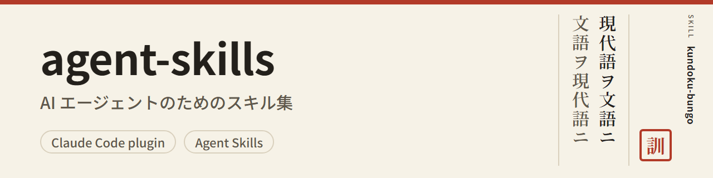

<p align="center">
  <b>文語</b> ・ <a href="README.md">現代語</a>
</p>

<p align="center">
  <picture>
    <source media="(prefers-color-scheme: dark)" srcset="docs/assets/banner-dark.png">
    
  </picture>
</p>

<p align="center">
  <a href="LICENSE"></a>
  <a href="https://code.claude.com/docs/en/plugins"></a>
  <a href="https://agentskills.io/"></a>
</p>

<p align="center">
  AI 代理機關ノ爲ノスキル集（<a href="https://agentskills.io/">Agent Skills</a> ノ <code>SKILL.md</code> 形式）<br>
  使ヒタキスキルノミヲ Claude Code ノ擴張トシテ入ルルコトヲ得
</p>

> [!NOTE]
> 此ノ文書ハ現代語ノ README ヲ本スキルニテ文語ニ改メタル戲レノ版ニシテ史料ニ非ス　正シキ内容ハ現代語ノ版ニ據ルヘシ

<p align="center">
  <a href="#スキルノ一覽">スキルノ一覽</a> ・
  <a href="#導入ノ法">導入ノ法</a> ・
  <a href="#他ノ代理機關npx-skills">npx skills</a> ・
  <a href="#更新及ヒ除去ノ法">更新及ヒ除去ノ法</a> ・
  <a href="#開發ノ手引">開發ノ手引</a> ・
  <a href="#使用ノ許諾">使用ノ許諾</a>
</p>

## スキルノ一覽

### `kundoku-bungo`

<a href="plugins/kundoku-bungo/.claude-plugin/plugin.json"></a>

現代ノ日本語ト明治ヨリ昭和 20 年頃ニ至ル公ノ書キ言葉（漢文訓讀體ノ普通文ニシテ法令・告諭・演説・新聞ノ論説等ノ文體ナリ）トヲ相互ニ變換ス

<table>
  <tr><th align="left">現代語（入力）</th><td>この規則に違反した者は、罰金に処する。ただし、事情によっては、その刑を軽くすることができる。</td></tr>
  <tr><th align="left">文語（出力）</th><td>此ノ規則ニ違反シタル者ハ罰金ニ處ス　但シ事情ニ依リテハ其ノ刑ヲ減輕スルコトヲ得</td></tr>
</table>

- 既定ノ表記ハ漢字片假名交シリニシテ舊字體ヲ用ヰ濁點及ヒ句讀點ヲ附セス　又平假名・新字體トシ濁點・句讀點ヲ附スルコトヲモ得
- 求メアラハ明治ノ前期・中期ノ合字「ヿ」（コト）及ヒ假名ノ踊リ字（ヽ・ゝ）ヲモ書ク　文語ヨリ現代語ニスル時ハ之ヲ假名ニ戾スコトヲ得
- 字ノ表（新字體ト舊字體トノ對應）及ヒ語ノ表（漢文訓讀ヨリ出テタル語）ニハ當時ノ文書（法令・告諭・演説等ノ飜刻及ヒ官報ノ畫像）ノ典據ヲ附シタリ
- 文語ヨリ現代語ヘノ譯ヲモ爲スコトヲ得
- 求メアラハ變換ノ理由（何處ヲ何故ニ變ヘタルカ）ヲ文法ノ節・語ノ表及ヒ字ノ表ノ典據ト共ニ表ニテ示ス
- OCR（畫像ヨリ字ヲ讀ミ取ル處理）ニテ讀ミ取リタル當時ノ文書ノ文ヨリ讀ミ違ヒノ見込ミアル所ヲ根據附キノ見直シノ候補トシテ擧ク

> [!NOTE]
> 出力ハ現代ノ作文ニシテ史料ニアラス　上ノ文語モ亦スキルヲ以テ變換セル例ナリ　「者」ハ既定ノ如ク互換漢字ノ舊字體（U+FA5B）ニシテソフトニ依リテハ新字體ト同シ形ニ見ユ

擴張ノ ID: `kundoku-bungo@bachikawa-skills` ・ [變更ノ記錄（Releases）](https://github.com/bachikawa/agent-skills/releases) ・ [出典及ヒ權利ノ表示](plugins/kundoku-bungo/skills/kundoku-bungo/NOTICE.md)

<!-- スキルヲ加ヘナハ上ト同シ形ヲ以テ節ヲ加フヘシ（→ docs/adding-a-skill.md） -->

## 導入ノ法

Claude Code ニ於テ次ノ 1 行ヲ實行スヘシ（`claude plugin validate` ノ案内ニ依レハ Claude Code 2.1.275 以降ヲ要ス　2.1.322 ニ於テ之ヲ確カメタリ）

```text
/plugin install kundoku-bungo --marketplace bachikawa/agent-skills
```

- 入レタルスキルハ `/kundoku-bungo:kundoku-bungo` ヲ以テ呼ヒ出スコトヲ得　依賴ノ内容ニ適ヘハ代理機關自ラ之ヲ用ヰルコトモ亦アリ
- 古キ版ノ Claude Code ヲ用ヰル時又ハ端末ヨリ入ルル時ハ下ノ「他ノ入レ方」ヲ開クヘシ

<details>
<summary>他ノ入レ方（市場ノ登錄・端末）</summary>

先ツ市場（其ノ名ハ `bachikawa-skills`）ヲ登錄シ然ル後ニスキルヲ選ヒテ入ルヘシ

```text
/plugin marketplace add bachikawa/agent-skills
/plugin install <スキル名>@bachikawa-skills
```

端末ニ於テハ次ノ命令ヲ以テモ亦同シコトヲ爲スコトヲ得

```bash
claude plugin marketplace add bachikawa/agent-skills
claude plugin install <スキル名>@bachikawa-skills
# or, in one line
claude plugin install <スキル名> --marketplace bachikawa/agent-skills
```

</details>

### 他ノ代理機關（npx skills）

Claude Code 以外ノ代理機關ニハ [skills](https://www.npmjs.com/package/skills)（`npx skills`）ヲ以テ入ルルコトヲ得　skills 1.8.1 ニ於テ之ヲ確カメタリ　1.8.1 ハ Node.js 22.20 以降ヲ要ス

```bash
npx skills@1.8.1 add bachikawa/agent-skills --skill kundoku-bungo
```

<details>
<summary>npx skills ノ注意（入ルル先・使用ノ記錄ノ送信）</summary>

- 版（`@1.8.1`）ヲ附スレハ確カメタル版ノママニ實行スルコトヲ得　之ヲ附セサレハ其ノ時ノ最新ノ版ヲ取リ來リテ實行ス
- 既定ニ於テハ現在ノ目錄（卽チ作業中ノ案件）ニ入ル　利用者全體ニ入ルル時ハ `-g` ヲ附スヘシ　入ルヘキ代理機關ハ `--agent` ヲ以テ選フコトヲ得
- 入ルモノハスキルノ目錄（`plugins/<スキル名>/skills/<スキル名>/`）ノ中身ノミナリ　`kundoku-bungo` ハ權利ノ表示（`LICENSE`・`LICENSE-UNICODE`・`NOTICE.md`）ヲ此ノ中ニ置キタルヲ以テ共ニ入ルナリ
- `npx skills` ハ使用ノ記錄ヲ匿名ニテ送ル　之ヲ送ラシメサル時ハ環境變數 `DISABLE_TELEMETRY=1`（又ハ `DO_NOT_TRACK=1`）ヲ設定シテ實行スヘシ　bash ニ於テハ `DISABLE_TELEMETRY=1 npx skills@1.8.1 add …` トシ PowerShell ニ於テハ先ツ `$env:DISABLE_TELEMETRY = "1"` ヲ實行スヘシ

</details>

## 更新及ヒ除去ノ法

<details>
<summary>Claude Code</summary>

自動更新ハ既定ニ於テ無效ナリ　次ノ何レカヲ以テ更新スヘシ

- `/plugin` ノ「Marketplaces」ノ欄ニ於テ `bachikawa-skills` ヲ選ヒ自動更新ヲ有效ニスヘシ
- 手ツカラ更新スヘシ

  ```bash
  claude plugin marketplace update bachikawa-skills
  claude plugin update <スキル名>@bachikawa-skills
  ```

更新ノ屆クハスキルノ版ノ上リタル時ニ限ル　各スキルノ變更ハ [Releases](https://github.com/bachikawa/agent-skills/releases) ニ於テ確カムルコトヲ得

之ヲ除ク時ハ `claude plugin uninstall <スキル名>@bachikawa-skills` ヲ實行スヘシ

</details>

<details>
<summary>npx skills</summary>

更新ハ `npx skills@1.8.1 update <スキル名>` ヲ以テシ除ク時ハ `npx skills@1.8.1 remove <スキル名>` ヲ以テ行フ　`-g` ヲ以テ入レタル時ハ何レニモ `-g` ヲ附スヘシ

</details>

## 開發ノ手引

<details>
<summary>倉庫ノ構成</summary>

```text
agent-skills/
├── .claude-plugin/
│   └── marketplace.json        # マーケットプレイスの定義（スキルの一覧）
├── plugins/
│   └── <スキル名>/              # 1 つのプラグインに、スキルを 1 つだけ入れる
│       ├── .claude-plugin/
│       │   └── plugin.json     # プラグインの定義と版
│       └── skills/
│           └── <スキル名>/
│               └── SKILL.md    # スキルの本体
├── tools/
│   └── <スキル名>/              # スキルのデータを作るツール（スキルと一緒には配らない）
└── docs/                       # 開発の資料
    └── assets/                 # README の画像（見出しの絵と、その元の HTML）
```

</details>

<details>
<summary>資料</summary>

| 資料 | 内容 |
| --- | --- |
| [スキルノ加ヘ方](docs/adding-a-skill.md) | 名ノ定メ・書類ノ雛形・檢證ノ法 |
| [版及ヒ公開ノ定メ](docs/releasing.md) | スキル每ノ版ノ上ケ方・標識ノ形（`<スキル名>--vX.Y.Z`）・公開ノ手順 |
| [kundoku-bungo ノ道具](tools/kundoku-bungo/README.md) | 字ノ表・語ノ表ノ典據ヲ取リテ表ヲ作リ直ス手順 |

</details>

<details>
<summary>枝ノ運用</summary>

| 枝 | 役割 | 分岐ノ元 | 倂合ノ先 |
| --- | --- | --- | --- |
| `main` | 前回ノ公開ノ狀態ナリ　利用者ハ此處ヨリ導入ス | — | — |
| `release_yyyymm` | 其ノ月ノ公開ノ準備（例: `release_202611`） | `main` | `main` |
| `dev_<Issue 番号>` | 1 箇ノ Issue ノ作業 | 公開ノ枝 | 公開ノ枝 |

- `main` 及ヒ公開ノ枝ニ直接變更ヲ書キ込ムヘカラス　變更ハ必ス PR ヲ經ヘシ
- 月ノ改マル時ニ公開ノ枝ヲ `main` ニ倂合シ版ノ上リタルスキル及ヒ新タニ加ヘタルスキルヲ公開ス（→ [公開ノ手順](docs/releasing.md#リリースの手順)）

</details>

## 使用ノ許諾

[MIT](LICENSE)

- `kundoku-bungo` は、Unicode の Unihan データベースから作った字の表（`plugins/kundoku-bungo/skills/kundoku-bungo/references/kanji.tsv`）を含む。この表にだけ、Unicode License v3 も当てはまる（[LICENSE-UNICODE](plugins/kundoku-bungo/skills/kundoku-bungo/LICENSE-UNICODE)、出典は [NOTICE.md](plugins/kundoku-bungo/skills/kundoku-bungo/NOTICE.md)）。
- 見出しの絵の文字は、Noto Sans JP と Noto Serif JP（SIL Open Font License 1.1）で書いた。
