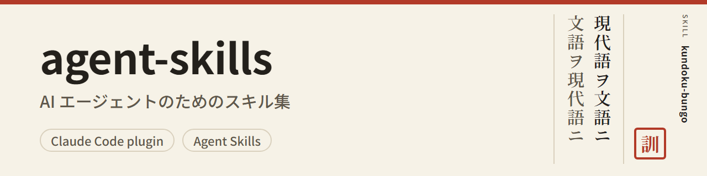

<p align="center">
  <b>現代語</b> ・ <a href="README.bungo.md">文語（お遊び版）</a>
</p>

<p align="center">
  <picture>
    <source media="(prefers-color-scheme: dark)" srcset="docs/assets/banner-dark.png">
    
  </picture>
</p>

<p align="center">
  <a href="LICENSE"></a>
  <a href="https://code.claude.com/docs/en/plugins"></a>
  <a href="https://agentskills.io/"></a>
</p>

<p align="center">
  AI エージェント用のスキル集（<a href="https://agentskills.io/">Agent Skills</a> の <code>SKILL.md</code> 形式）<br>
  使いたいスキルだけを、Claude Code のプラグインとして入れられる
</p>

<p align="center">
  <a href="#スキル">スキル</a> ・
  <a href="#インストール">インストール</a> ・
  <a href="#ほかのエージェントnpx-skills">npx skills</a> ・
  <a href="#更新と外し方">更新と外し方</a> ・
  <a href="#開発者向け">開発者向け</a> ・
  <a href="#ライセンス">ライセンス</a>
</p>

## スキル

### `kundoku-bungo`

<a href="plugins/kundoku-bungo/.claude-plugin/plugin.json"></a>

現代の日本語と、明治〜昭和 20 年ごろの公の書き言葉（漢文訓読体の普通文。法令・告諭・演説・新聞の論説などの文体）を、相互に変換する。

<table>
  <tr><th align="left">現代語（入力）</th><td>この規則に違反した者は、罰金に処する。ただし、事情によっては、その刑を軽くすることができる。</td></tr>
  <tr><th align="left">文語（出力）</th><td>此ノ規則ニ違反シタル者ハ罰金ニ處ス　但シ事情ニ依リテハ其ノ刑ヲ減輕スルコトヲ得</td></tr>
</table>

- 既定の表記は、漢字カタカナ交じり・旧字体・濁点なし・句読点なし。ひらがな・新字体・濁点あり・句読点ありにもできる。
- 求めれば、明治の前期・中期の合字「ヿ」（コト）と仮名の踊り字（ヽ・ゝ）も書く。文語から現代語にする時は、仮名に戻せる。
- 字の表（新字体と旧字体の対応）と語の表（漢文訓読から来た語）に、当時の文書（法令・告諭・演説などの翻刻と、官報の画像）の典拠を付けてある。
- 文語から現代語への訳もできる。
- 求めれば、どこをなぜ変えたかの理由を、文法の節・語の表・字の表の典拠と一緒に表で示す。
- OCR（画像から字を読み取る処理）で読み取った当時の文書の文から、読み違いの見込みがある所を、根拠付きの見直しの候補として挙げる。

> [!NOTE]
> 出力は現代の作文で、史料ではない。上の文語も、スキルで変換した例である。「者」は、既定のとおり互換漢字の旧字体（U+FA5B）で、ソフトによっては新字体と同じ形に見える。

プラグイン ID: `kundoku-bungo@bachikawa-skills` ・ [変更の記録（Releases）](https://github.com/bachikawa/agent-skills/releases) ・ [出典と権利の表示](plugins/kundoku-bungo/skills/kundoku-bungo/NOTICE.md)

<!-- スキルを足したら、上と同じ形で節を足す（→ docs/adding-a-skill.md） -->

## インストール

Claude Code で、次の 1 行を実行する（`claude plugin validate` の案内では Claude Code 2.1.275 以降。2.1.322 で確かめた）。

```text
/plugin install kundoku-bungo --marketplace bachikawa/agent-skills
```

- 入れたスキルは、`/kundoku-bungo:kundoku-bungo` で呼び出せる。依頼の内容に合えば、エージェントが自分で使うこともある。
- 古い版の Claude Code や、ターミナルから入れる時は、下の「ほかの入れ方」を開く。

<details>
<summary>ほかの入れ方（マーケットプレイスの登録・ターミナル）</summary>

マーケットプレイス（名前は `bachikawa-skills`）を登録してから、スキルを選んで入れる。

```text
/plugin marketplace add bachikawa/agent-skills
/plugin install <スキル名>@bachikawa-skills
```

ターミナルからは、次のコマンドでも同じことができる。

```bash
claude plugin marketplace add bachikawa/agent-skills
claude plugin install <スキル名>@bachikawa-skills
# or, in one line
claude plugin install <スキル名> --marketplace bachikawa/agent-skills
```

</details>

### ほかのエージェント（npx skills）

Claude Code 以外のエージェントには、[skills](https://www.npmjs.com/package/skills)（`npx skills`）で入れられる。skills 1.8.1 で確かめた。1.8.1 は Node.js 22.20 以降が要る。

```bash
npx skills@1.8.1 add bachikawa/agent-skills --skill kundoku-bungo
```

<details>
<summary>npx skills の注意（入れる先・使った記録の送信）</summary>

- 版（`@1.8.1`）を付けると、確かめた版のまま実行できる。付けないと、その時の最新の版を取ってきて実行する。
- 既定では、今のディレクトリ（プロジェクト）に入れる。ユーザー全体に入れる時は `-g` を付ける。入れるエージェントは `--agent` で選べる。
- 入るのは、スキルのディレクトリ（`plugins/<スキル名>/skills/<スキル名>/`）の中身だけである。`kundoku-bungo` は、権利の表示（`LICENSE`・`LICENSE-UNICODE`・`NOTICE.md`）をこの中に置いているので、一緒に入る。
- `npx skills` は、使った記録を匿名で送る。送らない時は、環境変数 `DISABLE_TELEMETRY=1`（または `DO_NOT_TRACK=1`）を設定して実行する。bash では `DISABLE_TELEMETRY=1 npx skills@1.8.1 add …`、PowerShell では先に `$env:DISABLE_TELEMETRY = "1"` を実行する。

</details>

## 更新と外し方

<details>
<summary>Claude Code</summary>

自動更新は、既定でオフである。次のどちらかで更新する。

- `/plugin` の「Marketplaces」タブで `bachikawa-skills` を選び、自動更新を有効にする。
- 手で更新する。

  ```bash
  claude plugin marketplace update bachikawa-skills
  claude plugin update <スキル名>@bachikawa-skills
  ```

更新が届くのは、スキルの版が上がった時だけである。各スキルの変更は、[Releases](https://github.com/bachikawa/agent-skills/releases) で確かめられる。

外す時は `claude plugin uninstall <スキル名>@bachikawa-skills` を実行する。

</details>

<details>
<summary>npx skills</summary>

更新は `npx skills@1.8.1 update <スキル名>`、外す時は `npx skills@1.8.1 remove <スキル名>` で行う。`-g` で入れた時は、どちらにも `-g` を付ける。

</details>

## 開発者向け

<details>
<summary>リポジトリの構成</summary>

```text
agent-skills/
├── .claude-plugin/
│   └── marketplace.json        # マーケットプレイスの定義（スキルの一覧）
├── plugins/
│   └── <スキル名>/              # 1 つのプラグインに、スキルを 1 つだけ入れる
│       ├── .claude-plugin/
│       │   └── plugin.json     # プラグインの定義と版
│       └── skills/
│           └── <スキル名>/
│               └── SKILL.md    # スキルの本体
├── tools/
│   └── <スキル名>/              # スキルのデータを作るツール（スキルと一緒には配らない）
└── docs/                       # 開発の資料
    └── assets/                 # README の画像（見出しの絵と、その元の HTML）
```

</details>

<details>
<summary>資料</summary>

| 資料 | 内容 |
| --- | --- |
| [スキルの足し方](docs/adding-a-skill.md) | 名前の決まり、ファイルの雛形、検証の方法 |
| [バージョンとリリースの決まり](docs/releasing.md) | スキルごとの版の上げ方、タグの形（`<スキル名>--vX.Y.Z`）、リリースの手順 |
| [kundoku-bungo のツール](tools/kundoku-bungo/README.md) | 字の表・語の表の典拠を取り、表を作り直す手順 |

</details>

<details>
<summary>ブランチ運用</summary>

| ブランチ | 役割 | 切り元 | マージ先 |
| --- | --- | --- | --- |
| `main` | 前回のリリースの状態。利用者は、ここからインストールする | — | — |
| `release_yyyymm` | その月のリリースの準備（例: `release_202611`） | `main` | `main` |
| `dev_<Issue 番号>` | 1 つの Issue の作業 | リリースブランチ | リリースブランチ |

- `main` とリリースブランチには、直接コミットしない。変更は、必ず PR を通す。
- 月が変わる時に、リリースブランチを `main` にマージし、版が上がったスキルと新しく足したスキルをリリースする（→ [リリースの手順](docs/releasing.md#リリースの手順)）。

</details>

## ライセンス

[MIT](LICENSE)

- `kundoku-bungo` は、Unicode の Unihan データベースから作った字の表（`plugins/kundoku-bungo/skills/kundoku-bungo/references/kanji.tsv`）を含む。この表にだけ、Unicode License v3 も当てはまる（[LICENSE-UNICODE](plugins/kundoku-bungo/skills/kundoku-bungo/LICENSE-UNICODE)、出典は [NOTICE.md](plugins/kundoku-bungo/skills/kundoku-bungo/NOTICE.md)）。
- 見出しの絵の文字は、Noto Sans JP と Noto Serif JP（SIL Open Font License 1.1）で書いた。
